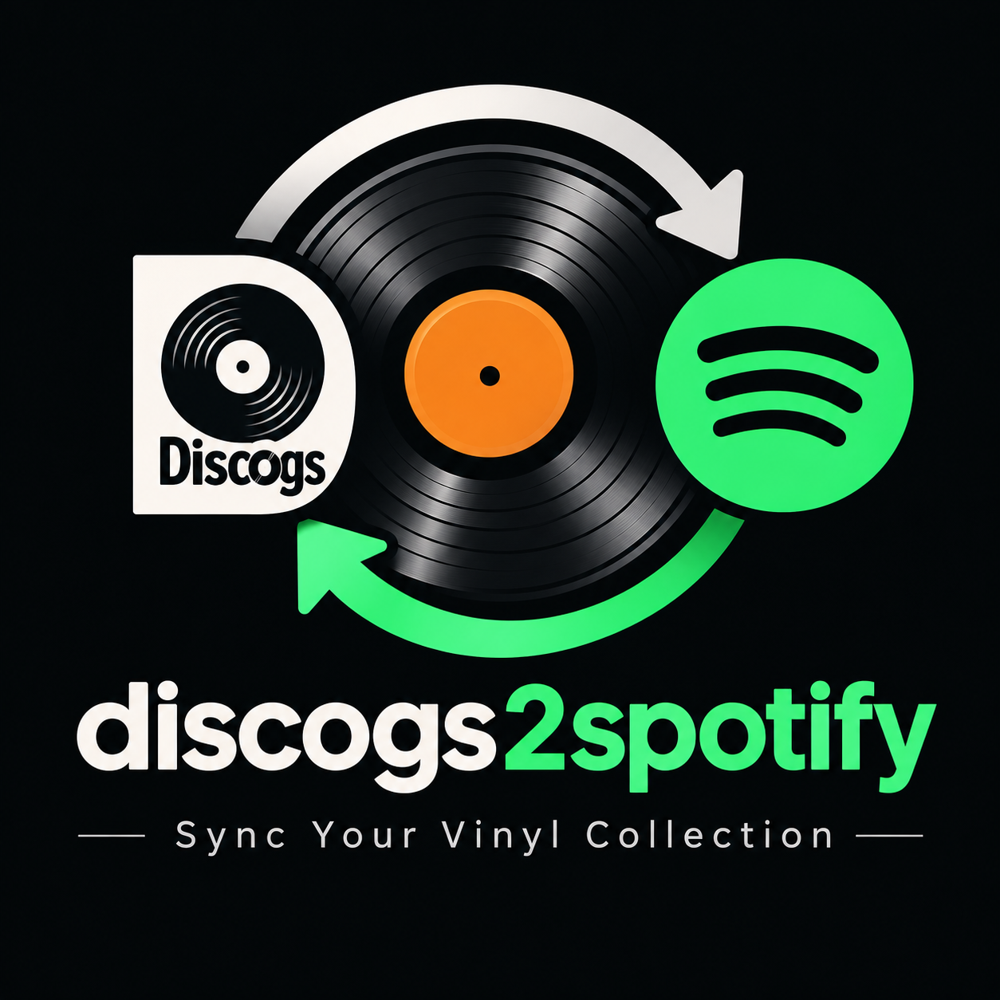

# discogs2spotify

`discogs2spotify.sh` is a shell-first command-line synchronizer. Discogs is the
source of truth, Spotify playlists are the derived representation, and SQLite
stores the mapping needed for safe repeat runs. Python 3.9+ performs API,
matching, state and synchronization work.



The tool creates one playlist per unique Discogs release. It uses exact release
IDs internally, the Discogs tracklist as the playlist order, and release-specific
artwork and edition metadata. It does not create physical playlist folders:
Spotify's Web API cannot manage playlist folders. Discogs folder associations
are retained in SQLite and included in playlist descriptions. Playlist names
are `[SPOTIFY_PLAYLIST_ROOT]-[Artist]_[Title]`; duplicate names receive
deterministic numeric suffixes. Managed playlists are renamed to this convention
on their next synchronization.

## Install

```bash
python3 -m pip install -r requirements.txt
cp discogs2spotify.conf.example discogs2spotify.conf
```

Set `DISCOGS_USER` in `discogs2spotify.conf`. Place a Discogs personal access
token in `~/.config/discogs/token`; it is read from disk and never printed.

Create a Spotify app in the Spotify developer dashboard and register this exact
redirect URI:

```text
http://127.0.0.1:8888/callback
```

Save only the app's client ID in
`~/.config/discogs2spotify/spotify-client-id`. The tool uses Spotify
Authorization Code with PKCE; it does not need or store a client secret. Start
authorization once:

```bash
./discogs2spotify.sh --auth
```

The refreshed Spotify token is stored with owner-only permissions under
`~/.config/discogs2spotify/spotify-token`. The default OAuth scopes are
`playlist-read-private`, `playlist-modify-private`, and `ugc-image-upload`.
Set `SPOTIFY_PUBLIC_PLAYLISTS=true` in the config to additionally request
`playlist-modify-public`.

## Safe first run

The default is a read-only dry run; it never writes to Spotify or to the
synchronization database:

```bash
./discogs2spotify.sh --dry-run
```

Review the proposed playlist and track changes, then explicitly apply them:

```bash
./discogs2spotify.sh --sync
```

`--report` also performs a read-only inventory. `--help` lists all options.
Repeat folder filters to select multiple folders; folder names with spaces or
punctuation are passed as one quoted shell argument:

```bash
./discogs2spotify.sh --dry-run --folder Blues --folder "Soul - Funk"
./discogs2spotify.sh --sync --exclude For-Sale
```

To synchronize one Discogs release directly, use its numeric release ID. This
does not list the user's collection and does not apply collection folder
filters:

```bash
./discogs2spotify.sh --dry-run --release-id 577332
./discogs2spotify.sh --sync --release-id 577332
```

File logging is disabled by default. Set `LOG_TO_FILE=true` in the
configuration, or pass `--log-file` (and `--no-log-file` to override the
configuration); logs are also written to `./logs/discogs2spotify.log`. The
`logs/` directory is ignored by Git.

## Optional Discogs utility scripts

The scripts in `utils/` are standalone helpers; they do not participate in the
Spotify synchronization or change Discogs data.

### Enrich a collection CSV

`utils/discogs-enrich-collection.sh` reads a Discogs collection CSV containing
a `release_id` column and writes a sibling file named
`<input>-enriched.csv`. It retains the original columns and fills in additional
release metadata, including year, country, labels, catalog numbers, format,
genre, style, master ID, identifiers, matrix/runout, notes, and Discogs URL.
Missing metadata columns are added to the output, and values are populated
from each release's API response.

It requires `curl`, `jq`, Python 3, and a Discogs token at
`~/.config/discogs/token`. It makes one Discogs release API request for each
non-empty release ID and waits one second between requests. For example:

```bash
./utils/discogs-enrich-collection.sh ./my-collection.csv
```

### Inspect individual releases

`utils/discogs-release.sh` fetches one or more Discogs release IDs, saves the
API response as JSON, and prints a readable text report for each release. It
requires `curl` and `jq`; if `~/.config/discogs/token` exists, the script uses
it for authenticated requests. Output is written to a `discogs-releases/`
directory under the current working directory:

```bash
./utils/discogs-release.sh 577332
./utils/discogs-release.sh 577332 9579823 5789680
```

For a large collection, limit each run to a number of not-yet-completed
releases, then rerun to continue:

```bash
./discogs2spotify.sh --sync --max-releases 50
```

Only releases whose source data changed or whose previous synchronization did
not complete are pending. The batch limit applies after this check, so a failed
release is retried and completed releases do not use up the batch. A local
operating-system lock prevents overlapping synchronization processes; it is
released automatically if the process exits or is terminated.

The collection folder and release-list pages are still read in full so folder
filters and collection-level reporting remain accurate. Full release details
are fetched incrementally and stop once the requested number of pending
releases is found. Completed releases encountered before that point are checked
but do not count toward the limit.

Spotify can return HTTP 429 responses. Short rate limits are automatically
retried using Spotify's `Retry-After` value. The synchronizer does not block
for longer server-requested waits; it pauses, persists progress in SQLite, and
returns exit code `3` for a Spotify pause. Spotify quota exhaustion is reported
separately, along with the server-provided retry delay when available. Run the
same command again to resume pending releases; successfully matched tracks are
cached in the state database so a repeat run does not search for them again.
The SQLite schema is migrated automatically without deleting existing state.
`--max-releases` is a local pacing option, not a Spotify quota estimate or
limit.

CLI values override values in `discogs2spotify.conf`. `--folder` replaces the
configured include list, and `--exclude` replaces the configured exclude list.
Without an include list, every folder except excluded folders is selected.

## Configuration

The default file is `discogs2spotify.conf`. It accepts either KEY=value
settings or YAML; YAML is also accepted from files ending in `.yaml` or `.yml`
when supplied with `--config path.yaml`. Important settings include:

```text
DISCOGS_USER=bradz667
SPOTIFY_PLAYLIST_ROOT=My_record_collection
INCLUDE_FOLDERS=
EXCLUDE_FOLDERS=For-Sale
SYNC_DELETIONS=false
DRY_RUN=true
MATCH_THRESHOLD=90
AMBIGUOUS_MATCH_ACTION=skip
MISSING_TRACK_ACTION=report
DUPLICATE_TRACK_ACTION=skip
STATE_FILE=~/.config/discogs2spotify/state.db
LOG_LEVEL=INFO
SPOTIFY_API_DELAY=2.0
```

`AMBIGUOUS_MATCH_ACTION` accepts:

- `skip` (default): if the two highest-scoring Spotify track candidates both
  meet `MATCH_THRESHOLD` and are less than 3 score points apart, mark the
  track ambiguous instead of choosing one. Other tracks in the release can
  still be synchronized.
- `best`: in that same case, choose the highest-scoring candidate. If scores
  tie, the candidate with the lexicographically smaller Spotify track ID wins.

This setting does not relax `MATCH_THRESHOLD`: a candidate below the threshold
is not selected by either action. Ambiguous album results fall back to
individual track searches; this setting controls how ambiguity among those
track candidates is handled.

`MISSING_TRACK_ACTION` accepts `report` (default) or `skip`. Both leave a
track without an accepted match out of the generated playlist sequence unless
a previously saved Spotify mapping can be retained. `report` adds a warning
for each missing track; `skip` suppresses those per-track warnings. Missing
tracks are still included in the report's missing-track count.

`DUPLICATE_TRACK_ACTION` accepts `skip` (default) or `allow`. When distinct
Discogs tracks resolve to the same Spotify track URI, `skip` rejects the later
match so that URI is not used for both tracks. `allow` keeps both occurrences
in the playlist. Repeated Discogs entries with the same normalized title and
artist can still appear more than once.

Spotify's published rate limit uses a rolling 30-second window, but its exact
request limit varies by app and quota mode and is not published as a fixed
number. The client spaces Spotify requests at least 2 seconds apart by
default; `SPOTIFY_API_DELAY` can increase that interval. Values below 1.05
seconds still use a 1.05-second minimum. This pacing reduces bursts but cannot
prevent a rate limit caused by other app activity or development-mode quota
buckets. On HTTP 429 the client honors `Retry-After` for short waits and pauses
instead of blocking for more than five minutes. Check the Spotify Developer
Dashboard's request graph and app quota mode if long 429 windows continue.

`LOG_LEVEL` accepts `DEBUG`, `INFO`, `WARNING`, or `ERROR`. The default `INFO`
shows startup phases and periodic release counts so a longer run visibly
progresses. Set `LOG_LEVEL=DEBUG` in the config, pass `--log-level DEBUG`, or
use `--debug` for per-request and per-track diagnostics. Command-line logging
options override the config; `--verbose` also enables per-release details.

`LOG_TO_FILE` accepts `true` or `false` and defaults to `false`. When enabled,
logs are written in addition to the console output to
`./logs/discogs2spotify.log` (relative to the current working directory); the
directory is created if needed and the file is appended to. Use `--log-file`
to enable it for one run or `--no-log-file` to disable it, overriding the
configuration value.

Description settings can enable/disable playlist descriptions, catalog number,
format, genre, style, notes, matrix, and Discogs URL. Available Discogs data is
included without inventing fields. The release URL is included by default.
Generated descriptions are single-line and limited to 300 UTF-8 bytes; they
start with the Discogs release marker and retain the optional URL so playlists
can be recovered if local state is lost.
Artwork uses the primary image of the exact Discogs release by default;
`ARTWORK_IMAGE_INDEX` may select another zero-based image index. Artwork is
converted/compressed in memory to a JPEG whose base64 payload is no larger than
256 KB. No image files are retained. If the release has no usable image, an
existing playlist cover is left untouched.

## Synchronization behavior and safety

- Matching first searches albums by artist and title, then uses album tracklist
  overlap and the existing conservative track matcher. Uncertain album results
  fall back to individual track searches; year is only a weak signal and
  country is not used to identify a Spotify album.
- Missing, ambiguous and rejected tracks are reported; a release can still
  synchronize successfully matched tracks. Unmapped current playlist entries
  are preserved rather than removed when a match failure makes their identity
  uncertain.
- Playlist IDs are stored by Discogs release ID. If state is missing, playlists
  are recovered only when their description contains the Discogs release marker.
  Multiple playlists claiming one release are reported and not modified. A
  stored playlist that is absent or returns HTTP 404 is treated as stale and
  replaced only after at least one track matches.
- A managed playlist is changed only when its ordered track URIs, generated
  description, or source artwork hash differs. Missing-track records are saved
  for later retries; successful track matches are cached and unresolved tracks
  are searched again during subsequent passes.
- SQLite defaults to `~/.config/discogs2spotify/state.db`. A missing state
  database is reconstructed from marked playlists where possible. Dry runs use
  an existing database read-only and do not create one.
- Orphaned managed playlists are reported, never deleted by the tool. Spotify
  has no normal playlist-delete endpoint. When `SYNC_DELETIONS=true` and an
  explicit `--sync` is used, tracks are cleared from listed orphaned managed
  playlists; the playlist itself is retained. No unmanaged playlist is changed.
- Discogs pagination, API 429/5xx/network retries and resumable SQLite writes
  are handled. Spotify requests are paced using `SPOTIFY_API_DELAY`;
  exceptionally long rate-limit waits stop with an actionable error instead
  of blocking for hours. API errors cause a non-zero exit; missing tracks are
  warnings.
- Completed release signatures, the limited-run cursor, and successful track
  mappings are stored in SQLite. A limited run continues at the next release;
  an interrupted release is retried first and can safely reconcile its
  playlist. Spotify does not publish a fixed request quota; no daily request
  limit is assumed.

Output includes playlist create/update/exist decisions, cover and description
statuses, match counts, missing-track details, duplicate/orphan reports, and
error totals.

## Tests

```bash
python3 -m unittest discover -s tests -v
bash -n discogs2spotify.sh
bash -n sync-playlists.sh
python3 -m compileall -q src discogs2spotify.py
```

Tests use mocked API responses and do not require Discogs or Spotify credentials.
